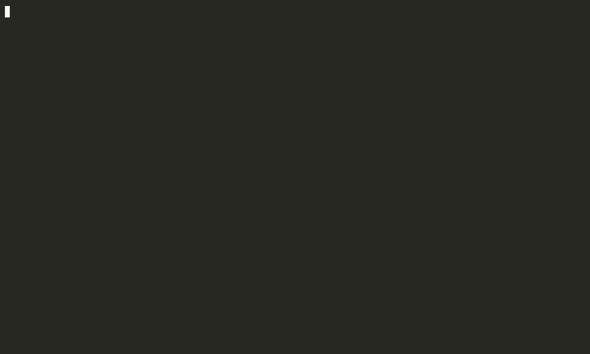

# Hydra

One command runs `claude`, `cursor-agent`, `agy` or `codex` in its own git worktree, behind a
deny-by-default policy, and leaves one JSONL record per run that says what actually happened.

Measured on macOS. On Linux it compiles and the test suite runs on `ubuntu-latest` since build
ticket 331, minus the seatbelt tests and nine tests skipped by name in `.github/workflows/ci.yml`:
two pty tests and seven bit-exact CPython arithmetic tests whose fixtures were recorded on an arm64
Mac. No sandbox wraps a Linux launch yet, so recorded runs stay on the Mac (map 119,
`docs/roadmap.md`).


## The record decides, not the vendor

All four CLIs exit 0 and report success on a run where every tool call was refused. That was
measured on 2026-09-22 on the versions `hydra doctor` prints, and it is the reason Hydra exists.
In the demo above `agy` says `result.status='SUCCESS'`; the record says `gated` and names the
refused call.

So the outcome is derived from the event stream. A run whose every tool call the gate refused is
`gated`. One refused call among calls that ran is a `permission_decision` on the record, not a run
outcome. A run that reached its own terminator is `failed` or `completed` by what that frame says,
`rate_limited` when `codex` hit its usage limit, `crashed` when the stream stopped without one. A
failed tool call does not fail the run. Four vendors, one contract, one outcome column.

What one run gets:

- **Its own git worktree**, seeded from your tree, so the agent sees your uncommitted work and
  cannot touch it. `hydra reap` commits what it did to `hydra/<run-id>` and removes the checkout.
  Your branch never moves.
- **A policy compiled into the vendor's own hook.** Five named policies, from `judge` (nothing)
  to `permissive`. The gate speaks each vendor's hook dialect and refuses if spoken to in the
  wrong one. On macOS a seatbelt profile around the whole run denies the same paths to every
  process, shell included. `SECURITY.md` says what the gate promises, what walks past it, and
  what it deliberately does not try to do.
- **An environment built from an allowlist**, not your shell. `src/env.rs` is the whole list, and
  a test there checks that the four vendors' API key names never reach the child. Hydra never
  handles a key: each CLI's own subscription login is the only way a run authenticates.
- **A record.** Every frame the vendor printed, verbatim, plus `run_start` and `run_end` with the
  outcome, token usage and the diff against the seeded tree. `docs/run-record-contract.md` is the
  format, the validator under `src/record/` checks it, and `hydra doctor --walk` checks every
  record on the machine.
- **No daemon, no database.** `~/hydra/runs/*.jsonl` is the source of truth. `hydra status`
  reconciles live pids against open records on demand.



`docs/demo/record.sh` records both gifs; the second launches nothing.

## Install

macOS, Rust 1.88 or newer, and at least one of the four CLIs installed and logged in.

```
git clone https://github.com/FrankMdza/hydra-harness ~/hydra && cd ~/hydra
cargo build --release --workspace
mkdir -p ~/.local/bin && ln -sf ~/hydra/target/release/hydra ~/.local/bin/hydra
hydra doctor
```

Hydra writes its runs, worktrees and skill store under `~/hydra/`, wherever the checkout lives;
the path above makes the two the same directory on purpose. `docs/install.md` has the rest: the
`PATH` rule, `HYDRA_ROOT` and `HYDRA_HOME`, what each vendor's login looks like from Hydra's side,
the measured versions, the local model server and the state of the ports.

## Quick start

```
hydra run --provider claude --task "add a test for the resolver"     # policy standard by default
hydra show 01a09                                                     # a prefix is enough
hydra reap 01a09                                                     # commit to hydra/<run-id>, remove the worktree
```

`--timeout 0` launches and returns at once, so several agents run side by side, and
`hydra wait <id>...` blocks until they have all ended. `hydra logs <id> --follow` tails one.

```
masterofpuppets ~/some-repo       # the orchestrator: a chat that runs a goal through plan, table and diffs
hydra cockpit                     # the viewer: tasks, runs by state, one run's detail
```

All four providers take a recorded run. The interactive mode, where the vendor draws its own
interface and Hydra harvests the transcript afterwards, is `claude` and `codex` today, and only
`claude` takes a policy there.

## Commands

| | |
|---|---|
| `run` | launch a provider on a recorded run |
| `status` | live pids against open records; worktrees waiting for a reap |
| `wait <run>... [--any] [--timeout 30m]` | block until selected runs end; exit 2 on timeout |
| `logs` | tail a record |
| `show` | the full record, normalized; `--events` for the stream; `--verdict` for the puppets goal-log verdict |
| `resume` | continue a finished run's vendor session under a fresh run id |
| `stop` | end a live run, `--all` of them, or `--session` and its seats |
| `reap` | commit a worktree to its branch, remove it |
| `prune` | move records out of `runs/`; deletes only behind a flag |
| `curate` | rung one: propose skill edits from the corpus |
| `evolve` | rung two: a proposer, the admission gate, a panel of four judges, a branch |
| `usage recount` | tokens across the corpus, recounted from the records |
| `export` | one JSON line of events per eligible run, and `preference.jsonl` beside it; the only path anything leaves this machine by |
| `approve`, `deny` | answer a seat request no approved panel shape covers |
| `models` | the models each vendor offers, from the last `models refresh`; launches nothing |
| `bench` | the attack-corpus benchmark of map 106: each class through `hydra run`, or the cost without launching |
| `cost` | an orchestrator's tokens against its agents', per named run and the median; launches nothing |
| `doctor` | the root, the binaries against the measured versions, the policy sha, the protected configs; `--walk` checks every record |
| `cockpit` | a goal's tasks, the runs in four lanes, one run's detail; with `--session claude` the ungated chat in the left panel |

`COCKPIT.md` is the cockpit's manual, the same table its `?` overlay shows. Two more commands
exist and clap hides them: `watch`, the detached half that owns the pty and the record, and
`delegate-face`, an MCP server that gives a run a typed `delegate` tool over `hydra run`.

## Master of Puppets

`masterofpuppets <repo>` is a chat that runs one goal end to end and launches nothing the human
has not approved. Four planners propose, one per vendor, each with a stance appended to its brief
(`minimal`, `risk`, `contrarian`, `builder`). The judges read the proposals as `Proposal A`, `B`,
`C`, `D` in a different order per seat, and the answers are mapped back to vendors afterwards.
The human approves the plan, then the assignment table, then each diff. `hydra-puppets`
(`crates/puppets/`) keeps the goal log and refuses any step out of order; `hydra-grader` reads
the logs back as labels. The chat itself is ungated and recorded; every agent it launches is
gated.

## It reads its own records

Rung one, `hydra curate`, proposes skill edits from the failure classes it finds in the corpus.
Rung two, `hydra evolve`, proposes patches to Hydra's own Rust behind an admission gate and a
panel of four judges, one per vendor. Nothing lands without a human merge. Ten passes so far and
one merged patch, on 2026-09-21, the first time all four judges said pass; before it, one critical
fail from any judge vetoed every patch, by design, and every pass found something real.
`docs/rungs-spec.md` is the design.

## How it compares

Worktree-per-run over several vendor CLIs is a crowded shelf; so is sandboxing. What is not on
the shelf is the record. Rows other than Hydra's are read from each project's own documents on
2026-10-15; a "no" means the project says nothing of it.

| | Drives several vendor CLIs | Worktree per run | OS sandbox | Policy | Record per run, contract-checked | Outcome derived from the stream |
|---|---|---|---|---|---|---|
| [Omnigent](https://github.com/omnigent-ai/omnigent) | yes, nine | yes | bwrap, seatbelt, egress proxy | approval, spend caps, tool caps | no | no |
| [Scion](https://github.com/GoogleCloudPlatform/scion) | yes, four | yes | a container per agent | isolation instead of rules | no | no |
| [OpenCode 2.0](https://github.com/anomalyco/opencode) | its own agent | can move a session into one | no | allow, ask, deny per tool | sessions persist | no |
| [ghostex](https://github.com/maddada/ghostex) | yes, seven | yes, per task | no | no | sessions persist | no |
| [ccmanager](https://github.com/kbwo/ccmanager) | yes | yes | no | a model asks whether a prompt needs a human | no | no |
| [Cupcake](https://github.com/eqtylab/cupcake) | yes | no | no | OPA Rego rules per event | no | no |
| Hydra | yes, four | yes | seatbelt on macOS | five policies compiled into the vendor's hook | yes | yes |

Omnigent has three platforms, an egress proxy and spend caps in dollars. Scion isolates the
process and the network. OpenCode has the users. ghostex has the workspace. Hydra has the record,
and `.scratch/hydra/research/129-ready-to-go-public.md` is the longer reading of the same shelf.

## What Hydra is not

- Not a chat UI and not an agent. The vendor's model thinks; Hydra decides where it may act and
  writes down what it did.
- Not a container. The gate refuses commands that name a protected path and declines to interpret
  shell, so `P=$HOME; echo x > $P/runs/x` walks past the gate; on macOS the seatbelt refuses that
  write anyway, measured on all four providers. Network cannot be cut, because the CLI needs its
  model.
- Not a trainer. Records export losslessly; weights are trained elsewhere.
- Not tested outside the author's machine.

## Status

| | |
|---|---|
| Commands | 20 a human types, 2 hidden |
| Test files | 41 under `tests/`, 23 under `crates/*/tests/`, run with `cargo nextest` |
| Records on the author's machine | 933 on 2026-10-15, every one checked by `hydra doctor --walk` |
| Build tickets | 327 opened, 312 resolved, every resolved one ending in an `## Outcome` |
| Design tickets | 129 on the map, 117 resolved |
| Written by agents through `hydra run` | most of the Rust since build 17; `docs/who-wrote-the-code.md` has the table |

`IMPLEMENTATION.md` is every departure from the design with its reason, 6,000 lines of them. Read
it before trusting a record. `CHANGELOG.md` is dated by when a change reached `master`, with run
ids as evidence. `docs/roadmap.md` is what is open.

## Design

`docs/harness-spec.md` is how Hydra launches, feeds and records the providers.
`docs/run-record-contract.md` is the format it writes and the rungs read. `docs/rungs-spec.md` is
both rungs of self-improvement. Nothing crosses between the harness and the rungs except the run
record and the skill store.

`.scratch/hydra/` is the design history: `map.md` and `issues/` are the decisions with their
reasoning, `build/` the tickets with what each run changed, `research/` the long findings. Those
files are written for the sessions that build Hydra and point at the author's private notes in
places; a reader needs `README.md`, `SECURITY.md` and `docs/`, and nothing else, to use it.
`CLAUDE.md` is what an agent working on Hydra reads first.

## Contributing, support, license

`CONTRIBUTING.md` says how a change gets in and what is not open to one. The most useful thing to
report is provider drift, and there is an issue template for it. If Hydra saves you a bad
afternoon, the sponsor button is how to say so; vendor tokens are the one cost this project cannot
avoid. Apache-2.0, see `LICENSE` and `NOTICE`.
